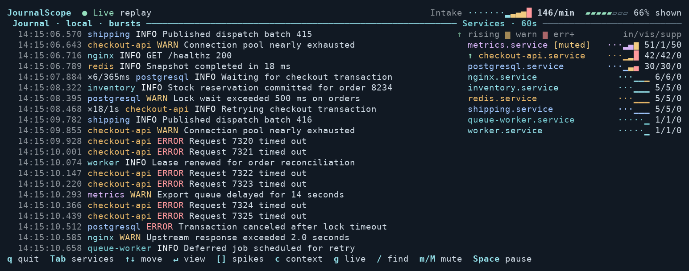
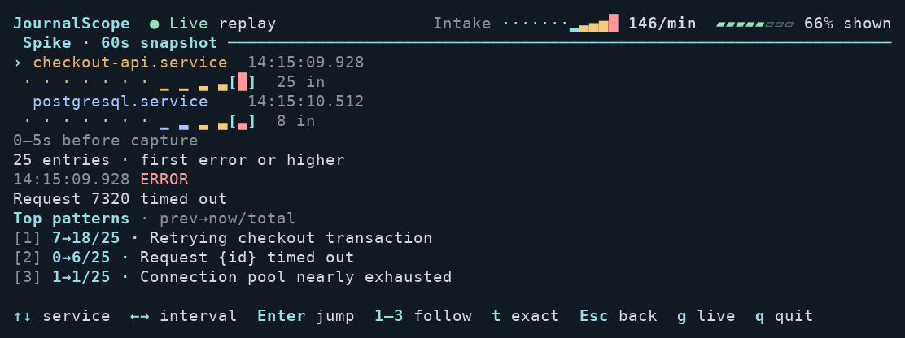
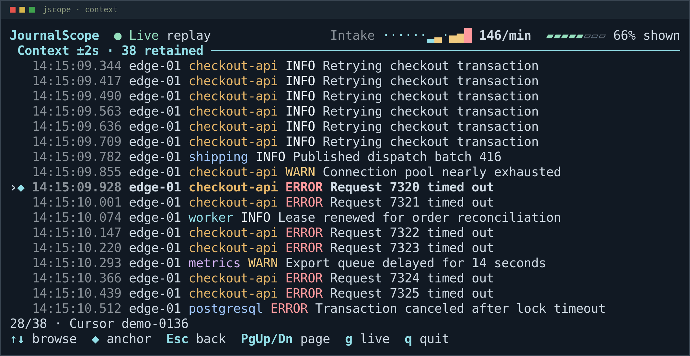

# JournalScope

**Which service just got noisy?** `jscope` watches the systemd journal from your terminal. A rolling one-minute graph ranks services by what they send. Pick a spike to see which messages drove it, land on the first error, and read what other services said around that exact instant.



## Run it

On Linux with Nix flakes enabled, pick a source. JournalScope follows `journalctl` with your existing journal access.

```sh
# From the authoritative repository on 16384.dev
nix run git+https://git.16384.dev/journalscope.git

# From the GitHub mirror
nix run github:adamloghry/jscope
```

From a checkout, run `nix run .` for the live journal or **`nix run .#demo`** for a synthetic replay. The demo also runs directly from the published flake.

```sh
nix run git+https://git.16384.dev/journalscope.git#demo
```

With Rust and Cargo on Linux, run `cargo install --locked --path .` from a checkout, then start the dashboard with `jscope`.

## Try it in a minute

1. Start `nix run .#demo`. The indexer leads with **9 incoming / 2 visible / 7 suppressed**. Its two warnings share a tail row even though routine polls are muted.
2. Press **Tab → Enter** to inspect the indexer. “Polling job queue” accounts for six of the nine arrivals in the selected five-second interval. Press **1**, then **→** to step through the six original journal cursors.
3. Press **c** on a poll to see what the proxy logged within two seconds of it. **Esc** returns to that exact poll. **g** takes you back to live.

## Inside a checkout timeout

The screenshots use a larger synthetic stream. In the dashboard above, metrics is the loudest service, while the rising arrow points to the checkout API. Pin PostgreSQL and open the API to put their graphs on the same clock. The last interval has 25 API entries and eight database entries. Press **t** to group the timeouts with different request IDs.



Select the timeout pattern, choose an occurrence, and press **c**. The diamond marks the original error. Here a connection-pool warning preceded request 7320 timing out, and a worker renewed its lease between two later timeouts. The cursor at the bottom identifies the exact selected entry.



## Controls

Mouse reporting is on by default in compatible terminals. Scroll over the journal to browse, then scroll to the newest entry to follow live again. Click a journal row for details, or click a service and a graph bar to investigate a spike. Right-click to go back. Use `--no-mouse` for native terminal text selection.

| From | Key | Action |
| --- | --- | --- |
| Journal | `[` / `]` | Hop between intervals with warnings or errors |
| Journal or followed message | `c` | Open the surrounding journal events |
| Services | `p` | Pin a service, then open another to compare both on the same clock |
| Spike inspector | `←` / `→`, `↑` / `↓` | Scrub time, or change the active service in a pair |
| Spike inspector | `t` | Group messages such as “request 183 timed out” and “request 942 timed out” as one pattern |
| Spike inspector | `1` / `2` / `3` | Follow a ranked message or pattern, with original timestamps and cursors |
| Dashboard | `/`, `s`, `m` / `M` | Search, solo a service, or mute routine traffic globally / per service |
| Dashboard | `Space`, `g`, `q` | Pause scrolling, return to live, or quit |

**Counts follow what journalctl sends, before JournalScope’s display filters.** The default live backlog is 200 matching entries. Use journalctl’s unit, boot, and priority selectors at the source, or pipe the same newline-delimited journal JSON from another machine.

```sh
jscope --boot --unit postgresql.service --priority warning --backlog 50
ssh HOST journalctl --follow --output=json --no-pager --lines=100 | jscope --input -
```

Rows show local journal time. Graphs use intake time, so a fast replay places historical entries in the same activity interval. Press **c** to see their order in journal time. JournalScope runs in the foreground and keeps bounded history in memory.

## On NixOS

Add the project to your system flake's inputs.

```nix
inputs.journalscope.url = "git+https://git.16384.dev/journalscope.git";
```

In your existing `nixosSystem` call, include the flake's module and your host settings. This example assumes the flake outputs bind the `journalscope` input by name.

```nix
modules = [
  ./configuration.nix
  journalscope.nixosModules.default
  {
    programs.jscope = {
      enable = true;
      backlog = 400;
      pinnedUnits = [ "postgresql.service" "nginx.service" ];
      mutedUnits = [ "indexer.service" ];
      generationMarkers.enable = true;
    };
  }
];
```

The optional marker records boots and live closure changes in the journal, including rollbacks. **G** jumps to the newest retained marker. Press it again for earlier activations. On a marker, **d** compares the two closures in the local Nix store. Markers travel with file and SSH replays. A package comparison needs both closures on the viewing machine.

## Build and verify

```sh
nix build                 # ./result/bin/jscope
nix flake check -L        # formatting, Clippy, Rust/Hegel, replay and terminal tests
nix build .#vm-test -L    # real journal follow, NixOS switches and shutdown in a guest
```

The flake targets `x86_64-linux` and `aarch64-linux`. See the [user guide](docs/guide.md) for grouping rules, keyboard controls and memory limits, and [verification status](STATUS.md) for the architectures actually exercised.

[Project home](https://16384.dev/journalscope) · [GitHub mirror](https://github.com/adamloghry/jscope) · Licensed under [MIT](LICENSE-MIT) or [Apache-2.0](LICENSE-APACHE), at your option.
